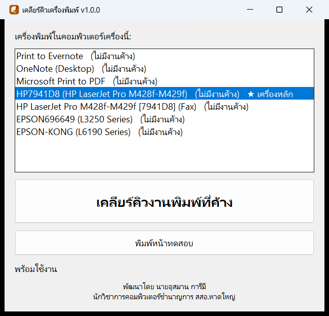

# เคลียร์คิวเครื่องพิมพ์ (Clear Print Queue)

โปรแกรมเล็ก ๆ สำหรับ Windows แก้ปัญหา **"สั่งพิมพ์แล้วไม่ออก"** ที่เกิดจากงานพิมพ์ค้างอยู่ในคิว จนงานถัด ๆ ไปพิมพ์ไม่ได้ทั้งหมด
กดปุ่มเดียวก็เคลียร์งานที่ค้างได้ ออกแบบมาให้คนที่ไม่ถนัดคอมพิวเตอร์ใช้เองได้



## ดาวน์โหลด

ดาวน์โหลดไฟล์ **`ClearPrintQueue.exe`** จากหน้า [Releases](https://github.com/usman-coe/clear-queue-printer/releases/latest)
เป็นไฟล์เดียว ไม่ต้องติดตั้ง คัดลอกไปวางบนหน้าจอ (Desktop) แล้วใช้ได้เลย

## วิธีใช้

1. ดับเบิลคลิก `ClearPrintQueue.exe`
2. Windows จะถามขออนุญาตให้โปรแกรมแก้ไขเครื่อง ให้กด **ใช่** (Yes)
3. กดปุ่ม **เคลียร์คิวงานพิมพ์ที่ค้าง** แล้วรอสักครู่
4. เมื่อขึ้นว่า **"เรียบร้อย! สั่งพิมพ์ใหม่ได้เลย"** ก็สั่งพิมพ์งานใหม่ได้ทันที
5. ถ้าอยากเช็กว่าเครื่องพิมพ์ใช้ได้แล้ว ให้เลือกเครื่องพิมพ์ในรายการ แล้วกด **พิมพ์หน้าทดสอบ**

> **ถ้าเปิดครั้งแรกแล้วขึ้นหน้าจอสีน้ำเงิน "Windows protected your PC"**
> ให้กด **More info** (ข้อมูลเพิ่มเติม) แล้วกด **Run anyway** (เรียกใช้ต่อไป)
> หน้าจอนี้ขึ้นเพราะโปรแกรมยังไม่มีลายเซ็นดิจิทัล ไม่ได้แปลว่ามีไวรัส

> **หมายเหตุ:** การเคลียร์คิวจะยกเลิกงานที่รอพิมพ์ **ทุกงาน** ของทุกเครื่องพิมพ์ ต้องสั่งพิมพ์งานที่ต้องการใหม่อีกครั้ง

## โปรแกรมทำอะไรบ้าง

- แสดงเครื่องพิมพ์ทั้งหมดในเครื่อง พร้อมจำนวนงานที่ค้าง และบอกว่าเครื่องไหนเป็น **เครื่องหลัก**
- ปุ่ม **เคลียร์คิวงานพิมพ์ที่ค้าง** ทำงานตามลำดับนี้
  1. หยุดบริการพิมพ์ของ Windows (Print Spooler)
  2. ลบไฟล์งานพิมพ์ที่ค้างในโฟลเดอร์ `C:\Windows\System32\spool\PRINTERS`
  3. เปิดบริการพิมพ์กลับมาใหม่
- ถ้าบริการพิมพ์ค้างจนสั่งหยุดไม่ได้ โปรแกรมจะบังคับปิดให้เอง
- ไม่ว่าขั้นตอนไหนจะผิดพลาด โปรแกรมจะเปิดบริการพิมพ์กลับมาเสมอ เครื่องจะไม่ถูกทิ้งไว้ในสภาพที่พิมพ์ไม่ได้

## ใช้กับเครื่องแบบไหนได้

- Windows 10 หรือ Windows 11 (64-bit)
- ต้องใช้บัญชีที่มีสิทธิ์ผู้ดูแลเครื่อง (admin) เพราะการหยุดและเปิดบริการพิมพ์ต้องใช้สิทธิ์นี้

## สำหรับนักพัฒนา

ต้องมี [Go](https://go.dev/) 1.26 ขึ้นไป และ [Task](https://taskfile.dev/) (ไม่บังคับ)

```sh
task            # build ClearPrintQueue.exe (version มาจาก git tag)
task test       # รันเทสต์
task release    # build แล้วสร้าง GitHub release ของ tag ปัจจุบัน
```

ไม่มี Task ก็ build ได้ด้วย `go build -ldflags="-H windowsgui -s -w" -o ClearPrintQueue.exe`

ออก version ใหม่:

```sh
git tag v1.1.0
git push origin v1.1.0
task release
```

โครงสร้างโปรเจกต์

| ไฟล์ | หน้าที่ |
|---|---|
| `main.go` | หน้าต่างโปรแกรมทั้งหมด เขียนด้วย [lxn/walk](https://github.com/lxn/walk) |
| `spooler/` | เรียก Win32 API เพื่ออ่านรายชื่อเครื่องพิมพ์และเคลียร์คิว |
| `rsrc_windows_amd64.syso` | manifest (ขอสิทธิ์ admin, หน้าตาปุ่มแบบใหม่) และไอคอน ลิงก์เข้า exe อัตโนมัติตอน `go build` |
| `winres/` | ไฟล์ต้นฉบับไอคอน (`icon.svg`, `icon.ico`) |

รายละเอียดเชิงเทคนิคเพิ่มเติม รวมถึงคำสั่งสร้างไฟล์ `.syso` ใหม่ อยู่ใน [CLAUDE.md](CLAUDE.md)

## ผู้พัฒนา

นายอุสมาน การีมี
นักวิชาการคอมพิวเตอร์ชำนาญการ สสอ.หาดใหญ่

## สัญญาอนุญาต

Copyright (C) 2026 นายอุสมาน การีมี

โปรแกรมนี้เป็นซอฟต์แวร์เสรี เผยแพร่ภายใต้สัญญาอนุญาต [GNU General Public License v3.0](LICENSE)
นำไปใช้ แก้ไข และแจกจ่ายต่อได้ ภายใต้เงื่อนไขของ GPL-3.0
